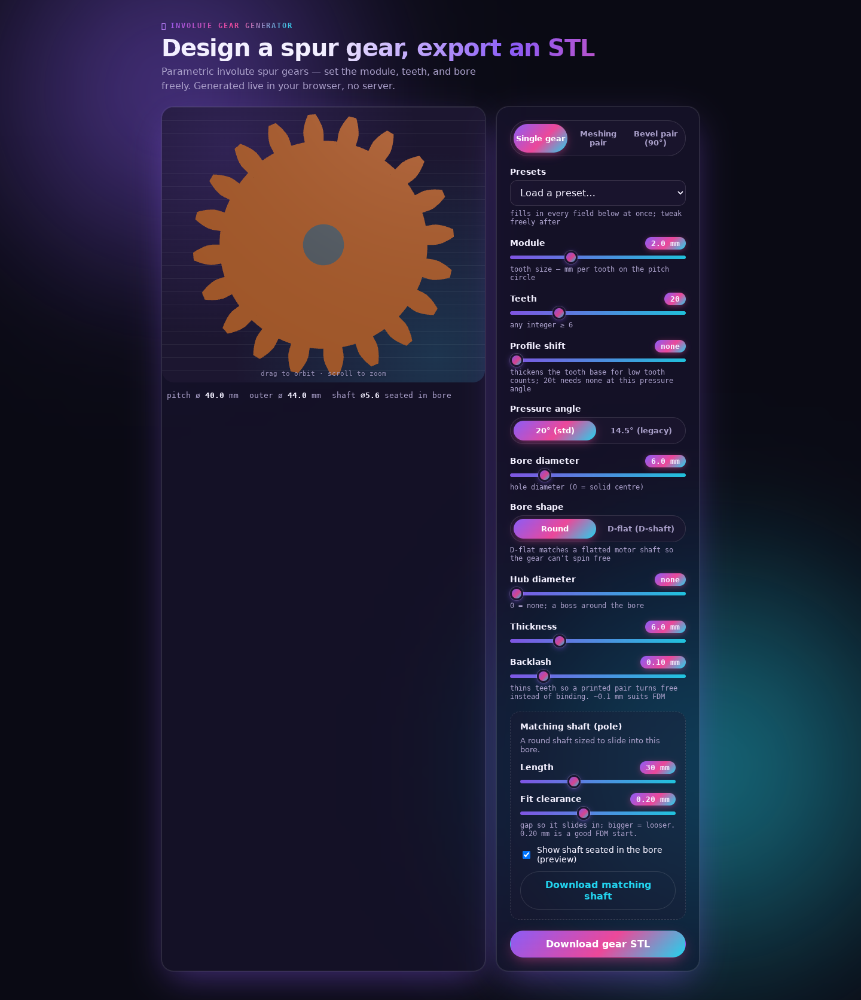

# Involute Gear Generator

A client-side, browser-based parametric **involute spur and straight bevel gear** generator built
in TypeScript (React + three.js). Set the module, teeth, pressure angle, bore,
hub, and thickness; see a live 3D preview; download a watertight binary `.stl`.
No server — it runs entirely in the browser and deploys as a static site.

**[Try the live demo](https://gear-generator-web-app.vercel.app/)**



## Features

- Single spur gears, animated meshing pairs, and straight bevel pairs for 90° shafts.
- Round or D-flat bores, adjustable hubs, backlash, and profile shift.
- Matching shaft downloads and preset designs.
- Interactive 3D previews and binary STL export, all in your browser.

The project lives in [`web-app/`](web-app/).

## Quick start

```bash
cd web-app
npm install
npm run dev      # dev server with live preview
npm run build    # static site -> web-app/dist/
npm test         # watertightness + dimensional test matrix
```

## Parameters

| Param           | Notes                                            |
|-----------------|--------------------------------------------------|
| `module`        | mm per tooth on the pitch circle (typ. 0.5–5)    |
| `teeth`         | integer ≥ 6                                       |
| `pressureAngle` | degrees, default 20 (14.5° legacy allowed)       |
| `boreDiameter`  | mm, plain round hole (0 = solid centre)          |
| `hubDiameter`   | 0 = none, or > bore (a boss around the bore)     |
| `thickness`     | mm                                               |

See [`web-app/README.md`](web-app/README.md) for geometry details and the full
verification matrix.

## License

[MIT](LICENSE). Third-party dependencies retain their own licenses.
